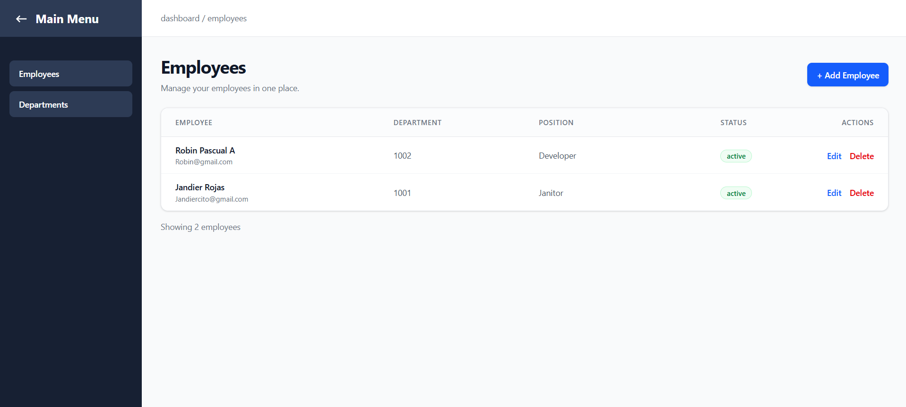
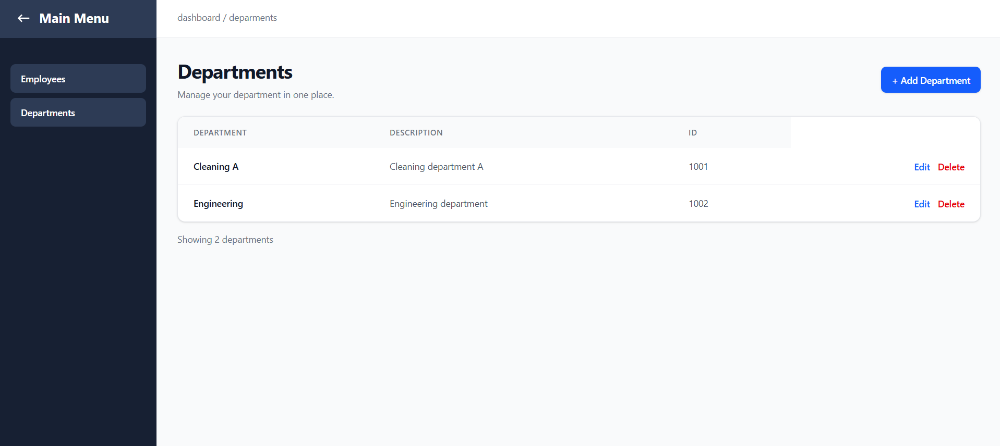
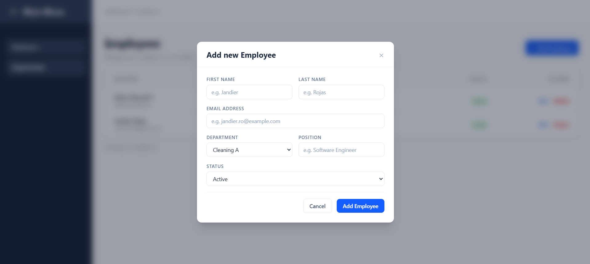
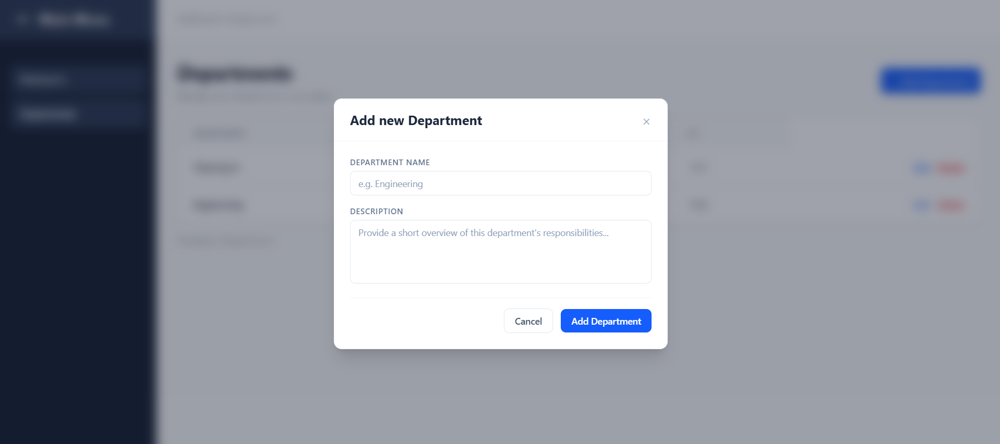

# Employee Management System – Frontend

## About the Project

This project is the frontend of an Employee Management System developed using React and TypeScript. It provides a user interface for managing employee records and departments, allowing users to create, view, update, and delete information.

The application communicates with a REST API developed with Java and Spring Boot. Axios is used to handle HTTP requests between the frontend and backend, while Spring Data JPA and MySQL handle data persistence.

## Features

### Employee Management
- View the list of employees retrieved from the backend API.
- Add new employees through a modal form.
- Edit existing employee information directly from the employee table.
- Delete employee records.

### Department Management
- View the list of departments.
- Create new departments using a modal form.
- Edit department names and descriptions.
- Delete department records.

### Additional Features
- **REST API Integration:** Uses Axios to communicate with the Spring Boot backend through HTTP requests.
- **Navigation:** Sidebar navigation between the Employees and Departments sections.
- **Dynamic Data:** Retrieves employee and department information from the backend when the application loads.
- **Form Validation:** Performs basic client-side validation to prevent submitting empty fields.
- **State Management:** Uses React hooks to manage application data and component state.
- **Reusable Components:** Uses reusable components for tables, modal windows, headers, and management sections.

## Technologies

| Technology | Purpose |
|---|---|
| JavaScript / TypeScript | Application logic and type definitions |
| React 19 | Frontend library |
| Axios | HTTP requests and API communication |
| Tailwind CSS 4 | Styling and layout |
| Material UI Icons | Interface icons |
| Vite | Development server and build tool |
| ESLint | Code linting |

## Application Architecture

The frontend communicates with the backend through REST API endpoints. The backend processes requests and interacts with the MySQL database.

```text
React + TypeScript
       |
       | Axios (HTTP Requests)
       |
       v
Spring Boot REST API
       |
       | Spring Data JPA
       |
       v
    MySQL
```

## Backend Integration

This frontend requires the Employee Management System backend to be running.

The application currently uses the following API endpoints:

| HTTP Method | Endpoint | Description |
|---|---|---|
| GET | `/api/employees` | Retrieve all employees |
| POST | `/api/employees` | Create an employee |
| PUT | `/api/employees/{id}` | Update an employee |
| DELETE | `/api/employees/{id}` | Delete an employee |
| GET | `/api/departments` | Retrieve all departments |
| POST | `/api/departments` | Create a department |
| PUT | `/api/departments/{id}` | Update a department |
| DELETE | `/api/departments/{id}` | Delete a department |

**Backend Repository:** [Employee Management System – Backend](https://github.com/JandierR/employee-management-system.git)

The current frontend configuration expects the backend API to be available at:

`http://localhost:8080`

## Installation

Follow these steps to run the application locally.

### Prerequisites

- [Node.js](https://nodejs.org/)
- npm
- A running instance of the Employee Management System backend.

### 1. Clone the repository

```bash
git clone https://github.com/JandierR/employee-management-system-frontend.git
```

### 2. Navigate to the project directory

```bash
cd employee-management-system-frontend
```

### 3. Install dependencies

```bash
npm install
```

### 4. Start the development server

```bash
npm run dev
```

### 5. Access the application

Open your browser and navigate to:

```text
http://localhost:5173
```

Make sure the backend API is running on port `8080` before using the application.

## Available Scripts

| Command | Description |
|---|---|
| `npm run dev` | Starts the Vite development server |
| `npm run build` | Runs TypeScript checks and builds the application |
| `npm run lint` | Runs ESLint to check the code |
| `npm run preview` | Previews the production build locally |

## Project Structure

```text
employee-management-system-frontend/
│
├── public/
│
├── src/
│   ├── Components/
│   │   ├── DepartmentManagement.tsx
│   │   ├── DepartmentModal.tsx
│   │   ├── DepartmentTable.tsx
│   │   ├── EmployeeManagement.tsx
│   │   ├── EmployeeModal.tsx
│   │   ├── EmployeeTable.tsx
│   │   ├── Header.tsx
│   │   ├── ModalWrapper.tsx
│   │   ├── NoSelected.tsx
│   │   ├── ReusableDashboardTop.tsx
│   │   ├── Sidebar.tsx
│   │   └── TableFooter.tsx
│   │
│   ├── Test/
│   │   └── ConnectionTest.tsx
│   │
│   ├── App.tsx
│   ├── App.css
│   ├── main.tsx
│   ├── style.css
│   └── Types.ts
│
├── index.html
├── package.json
├── tsconfig.json
├── vite.config.ts
└── README.md
```
## Screenshots

### Employee Dashboard



### Department Dashboard



### Add Employee



### Add Department


## Author

**Jandier R.**

[GitHub Profile](https://github.com/JandierR)
